# Despliegue de Arquitectura Web en Tres Niveles con Máquinas Virtuales y Vagrant
**Autor:** Pablo Alcón

---

## Introducción

El objetivo de esta práctica es diseñar, aprovisionar y asegurar una infraestructura de máquinas virtuales dividida en tres niveles de red independientes. Esta arquitectura permite aislar los servicios internos del acceso directo desde el exterior, distribuir el tráfico entre varios servidores web mediante balanceo de carga y cifrar las comunicaciones con los clientes finales.

La infraestructura se ha automatizado con Vagrant sobre VirtualBox utilizando máquinas virtuales con Ubuntu Server 22.04 LTS distribuidas de la siguiente manera:

- **Capa 1 (Red Pública):** Un servidor balanceador de carga con Nginx (`PabloAlconBalanceador`) expuesto a la red externa y protegido con un certificado SSL válido de Let’s Encrypt asociado a un nombre de dominio.
- **Capa 2 (Red Privada - Backend):** Dos servidores web con Apache y PHP (`PabloAlconWeb1` y `PabloAlconWeb2`) encargados de procesar las peticiones redirigidas desde el balanceador.
- **Capa 3 (Red Privada - Base de Datos):** Un servidor de base de datos MariaDB (`PabloAlconBBDD`) aislado, accesible únicamente desde los servidores web de la Capa 2.

---

## Arquitectura de red y aprovisionamiento con Vagrant

El despliegue completo de las cuatro máquinas virtuales, sus interfaces de red, los servicios y las reglas de cortafuegos se encuentra definido en el archivo Vagrantfile incluido en este documento , levantándose mediante el comando `vagrant up`.

### Vagrantfile completo

```bash
Vagrant.configure("2") do |config|
  config.vm.box = "bento/ubuntu-22.04"

  # Configuración común de recursos en VirtualBox
  config.vm.provider "virtualbox" do |vb|
    vb.memory = "1024"
    vb.cpus = 1
  end

  # SERVIDOR DE BASE DE DATOS (MariaDB)

  config.vm.define "bbdd" do |bbdd|
    bbdd.vm.hostname = "PabloAlconBBDD"
    bbdd.vm.provider "virtualbox" do |vb|
      vb.name = "PabloAlconBBDD"
    end
    bbdd.vm.network "private_network", ip: "192.168.30.20", virtualbox__intnet: "red-capa3"

    bbdd.vm.provision "shell", inline: <<-SHELL
      export DEBIAN_FRONTEND=noninteractive
      apt-get update && apt-get install -y mariadb-server ufw

      sed -i "s/127.0.0.1/192.168.30.20/" /etc/mysql/mariadb.conf.d/50-server.cnf
      systemctl enable --now mariadb
      systemctl restart mariadb

      mysql -u root <<EOF
      CREATE DATABASE IF NOT EXISTS practica_web;
      CREATE USER IF NOT EXISTS 'webuser'@'192.168.30.%' IDENTIFIED BY 'ContraseñaSegura123';
      GRANT ALL PRIVILEGES ON practica_web.* TO 'webuser'@'192.168.30.%';
      FLUSH PRIVILEGES;
      USE practica_web;
      CREATE TABLE IF NOT EXISTS mensajes (
          id INT AUTO_INCREMENT PRIMARY KEY,
          texto VARCHAR(100) NOT NULL
      );
      DELETE FROM mensajes;
      INSERT INTO mensajes (texto) VALUES ('Conexión exitosa con la Base de Datos en Capa 3');
EOF

      # Reglas del UFW (10.0.2.2)
      ufw default deny incoming
      ufw default allow outgoing
      ufw allow from 10.0.2.2 to any port 22 proto tcp
      ufw allow from 192.168.30.0/24 to any port 3306 proto tcp
      ufw --force enable
    SHELL
  end

  # SERVIDORES WEB BACKEND (Web1 y Web2)

  [
    { name: "web1", vm_name: "PabloAlconWeb1", ip_c2: "192.168.20.10", ip_c3: "192.168.30.10" },
    { name: "web2", vm_name: "PabloAlconWeb2", ip_c2: "192.168.20.11", ip_c3: "192.168.30.11" }
  ].each do |srv|
    config.vm.define srv[:name] do |web|
      web.vm.hostname = srv[:vm_name]
      web.vm.provider "virtualbox" do |vb|
        vb.name = srv[:vm_name]
      end
      web.vm.network "private_network", ip: srv[:ip_c2], virtualbox__intnet: "red-capa2"
      web.vm.network "private_network", ip: srv[:ip_c3], virtualbox__intnet: "red-capa3"

      web.vm.provision "shell", inline: <<-SHELL
        export DEBIAN_FRONTEND=noninteractive
        apt-get update && apt-get install -y apache2 php libapache2-mod-php php-mysql ufw
        systemctl enable --now apache2
        rm -f /var/www/html/index.html

        cat <<'EOF' > /var/www/html/index.php
<?php
$host = "192.168.30.20";
$user = "webuser";
$pass = "ContraseñaSegura123";
$db   = "practica_web";

$hostname = gethostname();
$server_ip = $_SERVER['SERVER_ADDR'];

echo "<h1>Arquitectura de 3 Niveles con Vagrant - Pablo Alcón</h1>";
echo "<p><strong>Servidor Backend:</strong> $hostname ($server_ip)</p>";

$conn = new mysqli($host, $user, $pass, $db);
if ($conn->connect_error) {
    echo "<p style='color:red;'>Error de conexión con BBDD: " . $conn->connect_error . "</p>";
} else {
    $result = $conn->query("SELECT texto FROM mensajes LIMIT 1");
    $row = $result->fetch_assoc();
    echo "<p style='color:green;'><strong>Estado BBDD:</strong> " . $row['texto'] . "</p>";
    $conn->close();
}
?>
EOF

        # Reglas UFW
        ufw default deny incoming
        ufw default allow outgoing
        ufw allow from 10.0.2.2 to any port 22 proto tcp
        ufw allow from 192.168.20.1 to any port 80 proto tcp
        ufw --force enable
      SHELL
    end
  end

  # BALANCEADOR DE CARGA (Con Nginx)

  config.vm.define "balanceador" do |bal|
    bal.vm.hostname = "PabloAlconBalanceador"
    bal.vm.provider "virtualbox" do |vb|
      vb.name = "PabloAlconBalanceador"
    end
    bal.vm.network "public_network"
    bal.vm.network "private_network", ip: "192.168.20.1", virtualbox__intnet: "red-capa2"

    bal.vm.provision "shell", inline: <<-SHELL
      export DEBIAN_FRONTEND=noninteractive
      apt-get update && apt-get install -y nginx certbot python3-certbot-nginx ufw
      systemctl enable --now nginx

      cat <<'EOF' > /etc/nginx/sites-available/balanceador
upstream backend_servers {
    server 192.168.20.10:80;
    server 192.168.20.11:80;
}

server {
    listen 80;
    server_name pabloalcon.duckdns.org;

    location / {
        proxy_pass http://backend_servers;
        proxy_set_header Host $host;
        proxy_set_header X-Real-IP $remote_addr;
        proxy_set_header X-Forwarded-For $proxy_add_x_forwarded_for;
        proxy_set_header X-Forwarded-Proto $scheme;
    }
}
EOF

      ln -sf /etc/nginx/sites-available/balanceador /etc/nginx/sites-enabled/
      rm -f /etc/nginx/sites-enabled/default
      nginx -t && systemctl restart nginx

      # Reglas UFW
      ufw default deny incoming
      ufw default allow outgoing
      ufw allow 22/tcp
      ufw allow 80/tcp
      ufw allow 443/tcp
      ufw --force enable
    SHELL
  end
end

```

Para segmentar correctamente las tres capas y evitar conflictos con la red NAT de gestión de VirtualBox (`10.0.2.0/24`), se han creado dos redes internas privadas (`red-capa2` y `red-capa3`) además de la interfaz en modo puente para el balanceador:

| Máquina Virtual | Capa | Red Externa / `red-capa2` | `red-capa3` |
| --- | --- | --- | --- |
| PabloAlconBalanceador | Capa 1 | Adaptador Puente (192.168.1.201/24) / 192.168.20.1/24 | Ninguna |
| PabloAlconWeb1 | Capa 2 | 192.168.20.10/24 | 192.168.30.10/24 |
| PabloAlconWeb2 | Capa 2 | 192.168.20.11/24 | 192.168.30.11/24 |
| PabloAlconBBDD | Capa 3 | Ninguna | 192.168.30.20/24 |

A continuación, se muestra la verificación del estado de las cuatro máquinas virtuales desplegadas mediante `vagrant status`:

Estado de las máquinas virtuales con vagrant status

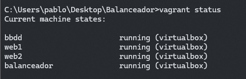

---

## Control de acceso y seguridad perimetral

Para permitir exclusivamente el tráfico necesario en cada subred y proteger las instancias, se ha configurado el cortafuegos UFW en todas las máquinas con política por defecto de denegación de tráfico entrante (`ufw default deny incoming`):

- **PabloAlconBalanceador (Capa 1):** Permite entrada únicamente en los puertos TCP 80 (HTTP), 443 (HTTPS) y 22 (SSH).
- **PabloAlconWeb1 y PabloAlconWeb2 (Capa 2):** Permiten tráfico entrante únicamente al puerto TCP 80 desde la IP del balanceador (`192.168.20.1`) y SSH de gestión local de Vagrant (`10.0.2.2`).
- **PabloAlconBBDD (Capa 3):** Permite tráfico entrante únicamente al puerto TCP 3306 procedente de la subred privada de backend (`192.168.30.0/24`) y SSH de gestión local de Vagrant (`10.0.2.2`).

Verificación de las reglas activas del cortafuegos UFW en la Capa 3:

Reglas de cortafuegos UFW aplicadas en Capa 3

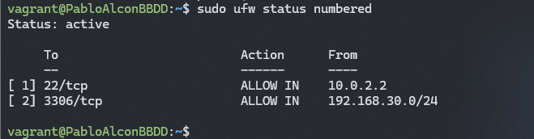

---

## Configuración de la Capa 3: Servidor de Base de Datos

Durante el aprovisionamiento de `PabloAlconBBDD` se instala MariaDB Server y se modifica `/etc/mysql/mariadb.conf.d/50-server.cnf` cambiando el parámetro `bind-address` a `192.168.30.20` para restringir la escucha únicamente a la interfaz privada de la Capa 3.

Posteriormente, se crea la base de datos `practica_web`, una tabla de verificación `mensajes` y un usuario (`webuser`) con permisos limitados a la subred `192.168.30.%`:

```sql
CREATE DATABASE IF NOT EXISTS practica_web;
CREATE USER IF NOT EXISTS 'webuser'@'192.168.30.%' IDENTIFIED BY 'ContraseñaSegura123';
GRANT ALL PRIVILEGES ON practica_web.* TO 'webuser'@'192.168.30.%';
FLUSH PRIVILEGES;
```

Comprobación del servicio MariaDB activo y en ejecución en `PabloAlconBBDD`:

Estado del servicio MariaDB en PabloAlconBBDD

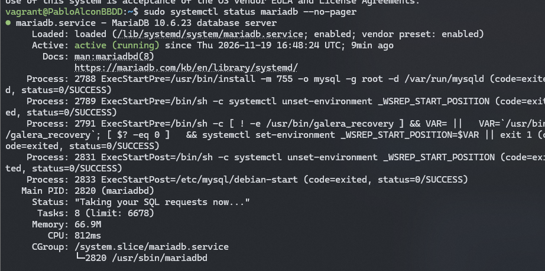

---

## Configuración de la Capa 2: Servidores Web Backend

En las instancias `PabloAlconWeb1` y `PabloAlconWeb2` se instala el servidor web Apache junto con PHP y el conector `php-mysql`. En ambos nodos se elimina la página por defecto y se despliega `/var/www/html/index.php`, que muestra el nombre de host y la dirección IP del servidor que atiende la solicitud, además de realizar una consulta en tiempo real contra `192.168.30.20` para validar la conectividad con la base de datos de la Capa 3.

Comprobación del servicio Apache y prueba local con `curl http://localhost` en `PabloAlconWeb1`:

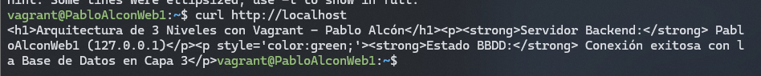

Estado de Apache y prueba local en PabloAlconWeb1

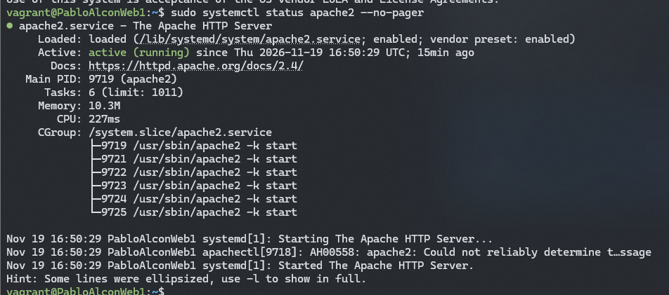

Comprobación del servicio Apache y prueba local con `curl http://localhost` en `PabloAlconWeb2`:

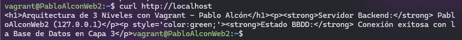

Estado de Apache y prueba local en PabloAlconWeb2

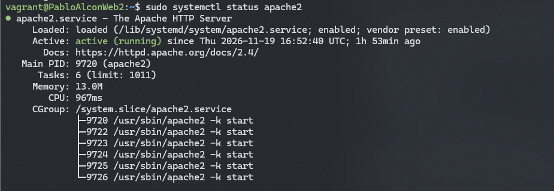

---

## Configuración de la Capa 1: Balanceador de Carga y SSL

### Instalación y configuración de Nginx

En `PabloAlconBalanceador` se instala Nginx para actuar como proxy inverso y balanceador de carga mediante el algoritmo *round-robin* por defecto. Se configura el archivo `/etc/nginx/sites-available/balanceador` con el bloque `upstream` apuntando a los dos servidores backend de la Capa 2:

```
upstream backend_servers {
    server 192.168.20.10:80;
    server 192.168.20.11:80;
}
```

Comprobación del servicio Nginx activo, interfaces de red (`ip -br a`) y prueba de balanceo mediante doble `curl http://localhost`, donde se aprecia que la primera petición responde desde `PabloAlconWeb1` (`192.168.20.10`) y la segunda desde `PabloAlconWeb2` (`192.168.20.11`):

Estado de Nginx, direccionamiento y prueba de balanceo

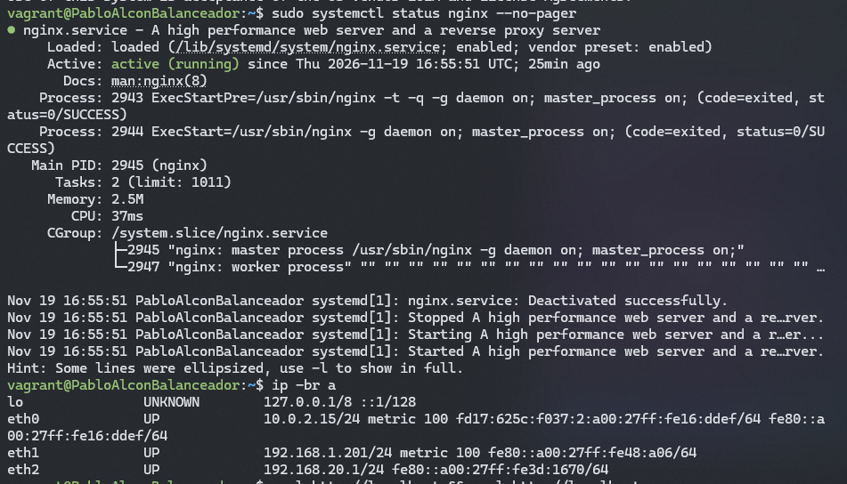

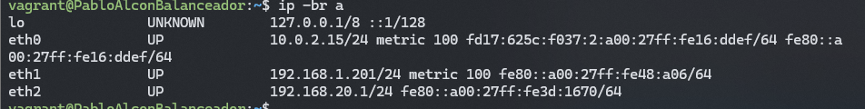

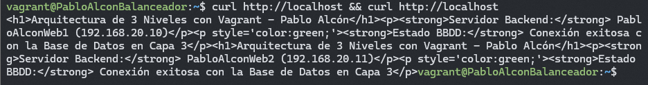

### Certificado SSL con Certbot y Let’s Encrypt

Se ha registrado el dominio gratuito `pabloalcon.duckdns.org` en DuckDNS:

Registro del dominio en DuckDNS

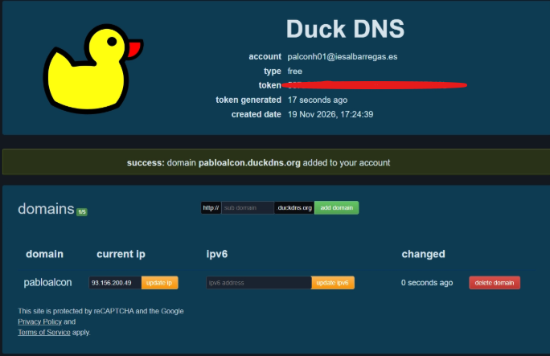

Al trabajar en un entorno local con máquinas virtuales sin abrir puertos en el router, la emisión del certificado válido de Let’s Encrypt se ha realizado mediante desafío DNS manual con Certbot:

```bash
sudo certbot certonly --manual --preferred-challenges dns -d pabloalcon.duckdns.org
```

Tras publicar el registro TXT de verificación en DuckDNS y confirmar su propagación mediante `nslookup`, Certbot emitió los certificados en `/etc/letsencrypt/live/pabloalcon.duckdns.org/`. A continuación, se actualizó `/etc/nginx/sites-available/balanceador` para redirigir todo el tráfico HTTP (puerto 80) hacia HTTPS (puerto 443):

```
server {
    listen 80;
    server_name pabloalcon.duckdns.org;
    return 301 https://$host$request_uri;
}

server {
    listen 443 ssl;
    server_name pabloalcon.duckdns.org;

    ssl_certificate /etc/letsencrypt/live/pabloalcon.duckdns.org/fullchain.pem;
    ssl_certificate_key /etc/letsencrypt/live/pabloalcon.duckdns.org/privkey.pem;

    location / {
        proxy_pass http://backend_servers;
        proxy_set_header Host $host;
        proxy_set_header X-Real-IP $remote_addr;
        proxy_set_header X-Forwarded-For $proxy_add_x_forwarded_for;
        proxy_set_header X-Forwarded-Proto $scheme;
    }
}
```

**Aclaración sobre la resolución local:** Para acceder al balanceador desde el equipo anfitrión utilizando el nombre de dominio real y validar el certificado sin necesidad de abrir puertos en el router, se añadió la entrada `192.168.1.201 pabloalcon.duckdns.org` en el archivo `C:\Windows\System32\drivers\etc\hosts` de Windows.

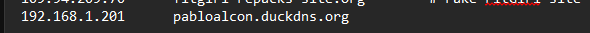

Verificación de la conexión cifrada mediante HTTPS con certificado válido en el navegador:

Certificado SSL válido en el navegador

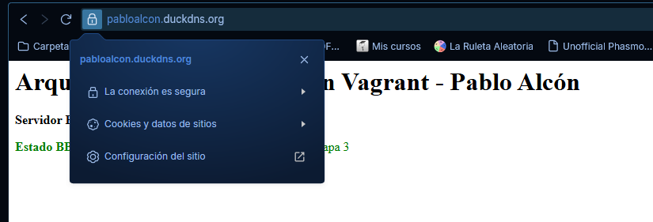

---

## Verificación y Screencast

Al acceder desde el navegador a `https://pabloalcon.duckdns.org` y recargar la página repetidamente, se comprueba que el balanceador `PabloAlconBalanceador` alterna las peticiones entre ambos servidores backend y que los dos mantienen conexión activa con la base de datos en Capa 3.

Petición atendida por `PabloAlconWeb1` (`192.168.20.10`):

Petición atendida por PabloAlconWeb1

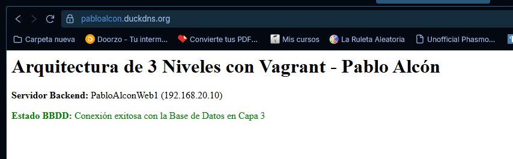

Petición atendida por `PabloAlconWeb2` (`192.168.20.11`) tras recargar la página:

Petición atendida por PabloAlconWeb2

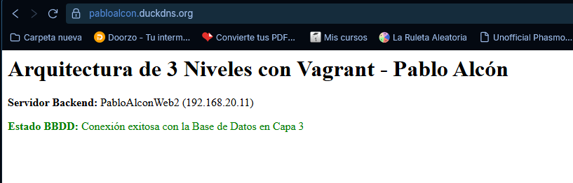

El vídeo demostrativo del funcionamiento completo de la aplicación se encuentra en la carpeta img/Demostracion.
